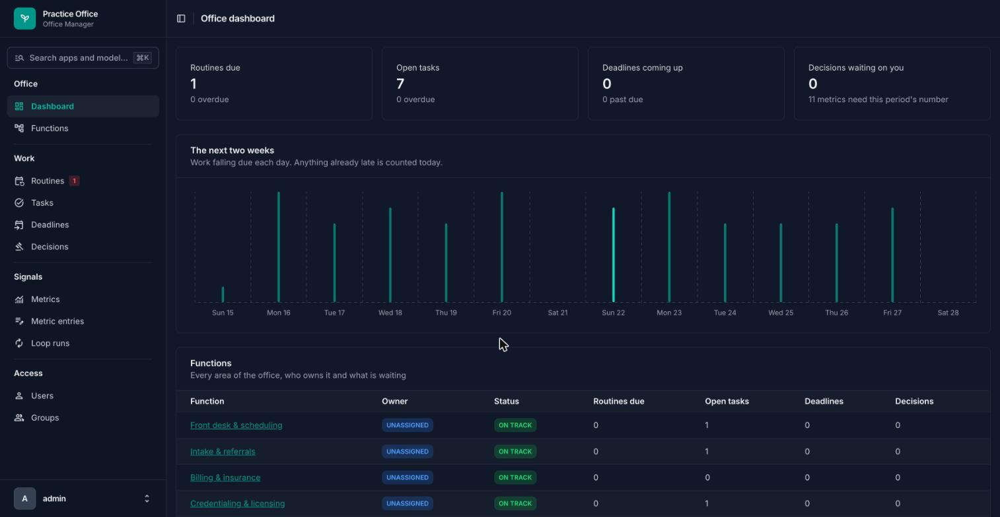
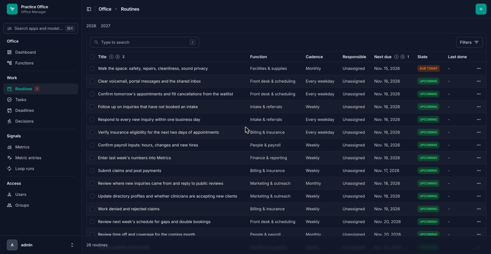

# Health Practice Loop

An office-manager dashboard for a mental health practice, and an AI loop that reviews it every
weekday morning.

The dashboard is a Django admin built with [django-unfold](https://github.com/unfoldadmin/django-unfold).
The loop is an [Egbe](https://egbe.ai) Business Loop run by Claude Code: it reads the board,
finds what is late, missing or drifting, raises tasks and decisions, and writes a short review
that appears on the dashboard.



## What it tracks

Ten functions of a practice office: front desk and scheduling, intake and referrals, billing and
insurance, credentialing and licensing, compliance and privacy, people and payroll, facilities,
technology and vendors, finance, and marketing. For each one:

| | |
|---|---|
| **Routines** | Recurring duties on a weekday, weekly, monthly, quarterly or yearly schedule. Marking one done moves it to its next occurrence. |
| **Tasks** | One-off work with an owner, a priority and a due date. |
| **Deadlines** | Dated obligations such as license renewals, payer recredentialing, insurance policies and leases, flagged ahead of time. |
| **Metrics** | One number per week or month, with a target and a direction. |
| **Decisions** | Choices that belong to the practice owner, with a recommendation. |
| **Loop runs** | What each review concluded and when the next one is. |



## No client data

There is no client model, on purpose. The board holds office work and counts, never client names
or clinical details. Those belong in the practice's EHR. This is a local development app and is
not set up to hold protected health information.

## Run it

Requires Python 3.13 and [Pipenv](https://pipenv.pypa.io).

```sh
pipenv install
cp .env.example .env.local        # then put a real key in DJANGO_SECRET_KEY
pipenv run python manage.py migrate
pipenv run python manage.py seed_office
pipenv run python manage.py createsuperuser
pipenv run python manage.py runserver
```

Open http://127.0.0.1:8000/. The admin is the whole app.

`seed_office` adds the ten functions, a starter set of routines, metric definitions and a few
setup tasks. It invents no numbers, dates or targets, and is safe to run again.

Tests: `pipenv run python manage.py test office`.

## The loop

| Command | What it does |
|---|---|
| `manage.py office_loop` | Prints the state of the board as a Markdown brief. Add `--json` for data. Changes nothing. |
| `manage.py office_loop --record ...` | Saves a review so the dashboard shows it. |
| `manage.py office_raise task ...` | Puts a task on the board. Raising the same open item twice does nothing. |
| `manage.py office_raise decision ...` | Puts a decision in front of the owner. |

The plan the loop follows, including what a run may and may not do, is in
[`egbe-docs/product/office-manager-loop.md`](egbe-docs/product/office-manager-loop.md).
Each run's report is under [`egbe-docs/reports/`](egbe-docs/reports/), and the schedule is
recorded in [`egbe-docs/routines.json`](egbe-docs/routines.json).

A run may read the board, raise tasks and decisions, and write its review. It may not mark work
done, change owners or targets, spend money, send email or publish anything.

### Running it unattended

[`bin/office-loop-run`](bin/office-loop-run) starts one pass with Claude Code in headless mode.
It is allowed to edit files in the project and to run [`bin/office`](bin/office), which accepts
only the two loop commands. To run it on weekday mornings on macOS, copy
[`ops/launchd.plist.example`](ops/launchd.plist.example) to `~/Library/LaunchAgents/`, set the
project path in it, and load it:

```sh
launchctl bootstrap gui/$(id -u) ~/Library/LaunchAgents/local.practice-office.loop.plist
```

### Egbe

The loop's method comes from Egbe's playbooks. They are Egbe's own material and are not included
in this repository. Installing the Egbe plugin for Claude Code and asking it to set up the
project copies `EGBE.md` and `egbe-docs/playbooks/` into your working copy:

```sh
claude plugin install egbe --marketplace egbe-ai/egbe-plugins
```

The dashboard and the loop commands work without Egbe.

## License

MIT. See [LICENSE](LICENSE).
